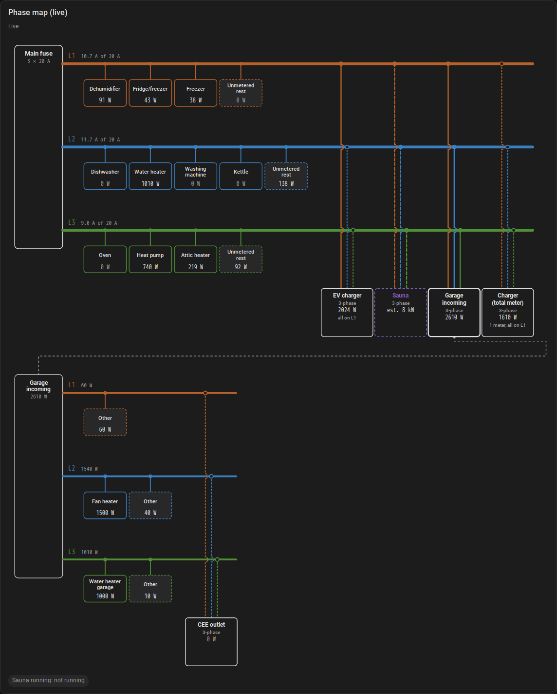

# HA Phase Map

**Know which load is on which phase of your main fuse, how much headroom each phase has, and
when something without a meter (a sauna, a heater) is drawing power.**


HA Phase Map is a Home Assistant custom integration. You tell it which sensors measure your
main fuse and add your power meters as loads on their phase, and it suggests the phase from
history when you add a meter. It then gives you:

- **Unmetered current per phase**: main-fuse current minus every load you have a meter for.
  Normally small; when it jumps, something without a meter is on.
- **Headroom per phase**: how far each phase is from the fuse rating.
- **Overload risk per phase**: a binary sensor that turns on when a phase stays close to the
  fuse rating.
- **Unmetered load detectors**: a binary sensor that turns on when unmetered current rises on
  the phases you choose. A three-phase sauna is the classic case: use the detector to block a
  heat pump while the sauna runs, so the main fuse does not blow.
- **A dashboard card** that draws it all as a single-line diagram. It comes with the
  integration; its source is [HA Phase Map Card](https://github.com/JanJoh/ha-phase-map-card).

Everything runs locally inside Home Assistant. There is no cloud service and no extra token.

## Before you start: you need a reliable meter on every phase

> [!IMPORTANT]
> HA Phase Map only makes sense if Home Assistant already has **trustworthy, frequently
> updated current or power readings for each phase at the main fuse**. Without that, do not
> install it: the numbers it produces will be wrong.

Almost everything here is a subtraction: *what the main fuse carries on a phase* minus *what
your meters account for on that phase*. Any error in the main-fuse reading lands directly in
"unmetered current", where it looks like a real load. A detector will then switch on (or fail
to switch on) for no reason, and a heat pump may be blocked when nothing is wrong.

Your main-fuse sensors must:

| Requirement | Why |
|---|---|
| **One sensor per phase**, not just a total for the house | Phases are the whole point: a sauna, an oven and an EV charger can each load a different phase |
| **Measure at the main fuse**, so all the house's consumption passes through it | A meter that misses a sub-panel makes everything on it look unmetered or invisible |
| **Update often**: every few seconds is ideal, once a minute is the limit | Detectors and the overload warning react to changes; minute-old values make them late |
| **Be accurate to about 0.1 A** | Small loads (fridges, 40 W) are found from steps of 0.2 A; a meter that rounds to whole amps can only place big loads |
| **Stay available** | While a main-fuse sensor is unavailable, that phase's sensors are unavailable too |
| **Be recorded as statistics** (`state_class: measurement`, the default for most power and current sensors) | Phase suggestions and the card's averages read the recorder's long-term statistics |

**Good sources:** a P1/HAN port reader that reports current or power *per phase*, a Shelly
Pro 3EM (or similar CT meter) on the incoming cables, Tibber Pulse with per-phase values, or a
load balancer for an EV charger that measures the main fuse (for example Garo Entity Balance).

**Not enough:** a meter that only gives total power for the house, hourly or daily data from
your electricity supplier, a cloud integration that updates every few minutes, or an
estimate.

Two more things worth knowing:

- Sensors in **W are converted to amps with the nominal voltage** you enter. Loads with a low
  power factor (motors, some electronics) draw more current than W / V suggests, so prefer
  current (A) sensors where you have them, especially for the main fuse.
- Check the main-fuse readings before you start: switch on something big (a kettle, an oven)
  and make sure exactly one phase rises by about the right amount within seconds.

## Requirements

- Home Assistant **2026.10** or newer (tested on 2026.10.0).
- **A reliable sensor per phase at the main fuse**, in A, mA, W or kW (see above).
- Power or current sensors for the loads you want to show. A Shelly Pro 3EM gives one sensor
  per phase; smart plugs give one sensor each.
- The **recorder** with long-term statistics (the default) for phase suggestions and averages.

Single-phase homes and split-phase (2 × 120 V) homes work too: choose 1 or 2 phases.

## Installation

Through [HACS](https://hacs.xyz):

[](https://my.home-assistant.io/redirect/hacs_repository/?owner=JanJoh&repository=ha-phase-map&category=integration)

1. **HACS → ⋮ → Custom repositories**, add `https://github.com/JanJoh/ha-phase-map` with type
   **Integration** (or use the button above).
2. Download **HA Phase Map** and restart Home Assistant.
3. Add the integration (see [Setup](#setup)).
4. **Reload the browser** (Ctrl+Shift+R; in the companion app: Settings → Companion app →
   Debugging → Reset frontend cache). The card is loaded when the page loads, so a page that
   was open while you added the integration does not have it yet, and *Phase Bus Card* is
   missing from the card picker until you reload.

Manual install: copy `custom_components/phase_map` into `config/custom_components/` and restart.

The dashboard card is included and loaded automatically: there is no separate card to install
and no dashboard resource to add. (If you installed the card on its own earlier, you can remove
that resource; leaving it does no harm.)

## Setup

**Settings → Devices & services → Add integration → HA Phase Map**

1. **Main fuse**: name, number of phases, phase voltage (230 V in most of Europe, 120 V in
   North America) and fuse rating per phase.
2. **Main fuse sensors**: the sensor for each phase.

Then, on the HA Phase Map entry, add:

- **Load → One meter on one phase**: pick the meter. The integration looks at the last
  10 days and suggests the phase, for example *"Dishwasher is probably on L2 (high
  confidence: 47 on/off steps, gain 1.03)"*. Change it if you know better.
- **Load → A multi-phase load**: one meter channel per phase, for example an EV charger or a
  stove measured by a Shelly Pro 3EM.
- **Load → One meter on one phase** also covers a **multi-phase load with only one meter**
  (a CEE outlet, a charger measured as a total): in the phase step, pick **Also connected to**
  for the other phases it is wired to, and how its power is counted (see below).
- **Load → A load without a meter (estimated)**: name, phases and estimated power. It is drawn
  dashed on the card.
- **Measured by** (asked after the details when you have other meters): if the load sits
  behind another meter you have added, pick that meter. See below.
- **Detector**: phases, minimum extra current per phase (an 8 kW three-phase sauna adds about
  11 A per phase), and delays. The off-delay keeps it on while a thermostat cycles.

Use **⋮ → Reconfigure** to change the fuse or its sensors. **Configure** has the settings
(overload warning margin and delay, phase labels, looking for new meters) and the suggested and
ignored meters.

### What HA Phase Map works out by itself, and what it doesn't

- **New meters, if you turn it on:** it looks once a day for power and current sensors you
  have not added, works out their phase (and the meter they sit behind), and offers the clearest
  ones under **Settings → Repairs**. It never adds anything by itself. See
  [Suggested meters](#suggested-meters).
- **The phase, when you add a load:** it suggests the phase from the last 10 days of history.
  See [How the phase suggestion works](#how-the-phase-suggestion-works).
- **Which meter a load sits behind:** *Measured by* is pre-selected from the Energy dashboard's
  upstream devices. See [Meters behind other meters](#meters-behind-other-meters).
- **Whether a load has moved:** after setup it watches every single-phase load's switch events
  and raises a repair when one seems to be on another phase. See
  [When a load moves to another phase](#when-a-load-moves-to-another-phase).
- **Not which unmetered load is running:** the unmetered current sensors say how much current
  per phase no meter explains, not what is drawing it. A
  [detector](#entities) turns that into an on/off signal for a load you know about, like a
  sauna.

### Suggested meters

HA Phase Map can look for meters you have not added yet and offer them, one repair at a time.
It is **off by default**: turn it on under **Configure → Settings → Suggest new meters**.

- **What it looks at:** sensors with device class *power* or *current*, state class
  *measurement* and unit W, kW, A or mA that no load uses. Skipped: the main-fuse meter and the
  other sensors of its device, energy (kWh) sensors, computed sensors (template, group,
  utility meter, powercalc and similar), hidden and disabled entities, and the power a network
  switch delivers over PoE.
- **One meter, one suggestion:** a sensor's power and current versions count once. The unit
  of your main-fuse sensors wins (current when they are in A), because then nothing is lost to
  power factor or voltage. A three-channel meter such as a Shelly Pro 3EM becomes **one
  multi-phase suggestion**, and its total is skipped. If some of its channels are already added
  (one appliance per channel), the free channels are suggested one by one. If its total is
  added (a CEE outlet with one meter), its channels are the same circuit and are not suggested.
- **The phase comes from the evidence, never from the name.** A channel called *c* or *L3*
  can be on any phase. A multi-phase meter's channels are matched to phases from the steps
  each one makes on its own. When that is not clear (a balanced 3-phase load that only ever
  switches on all phases at once), the mapping is offered as a guess, and you check it before
  adding.
- **Behind another meter:** taken from the Energy dashboard's *upstream device* when there is
  one, otherwise from history (the meter only ever steps together with one channel of a
  multi-channel meter you have added).
- **Only the clear ones:** high confidence by default (medium is a setting), at most **5** open
  at a time. When you add or ignore one, the next one appears. A scan runs once a day, 10
  minutes after Home Assistant starts the first time.
- **Each repair** offers *Add it as a load* (a form prefilled with the name, phase or channels
  and the meter it sits behind) or *Not a load: don't suggest it again*. Ignoring it in the
  Repairs list works too. A sensor whose load you delete is not suggested again either.
  **Configure → Ignored meters** brings them back.
- **Configure → Suggested meters** lists everything it found, also the ones it could not place,
  and can scan again now.

**From the Energy dashboard:** the devices under *Individual devices* in the Energy dashboard
are meters you have already picked out. **Configure → Suggest meters from the Energy
dashboard** offers those that are not added yet (from medium confidence), also while looking
for new meters is off. It is the quickest way to set up a new main fuse.

### How the phase suggestion works

Every time a meter steps up or down, the main-fuse phase it sits on should step by about the
same current while the other phases stay flat. The integration takes the meter's steps from
the 5-minute statistics, averages each phase's response in the direction of the step, and
reports the **gain** (about 1.0 on the right phase) and how clearly it stands out. Big loads
(dishwasher, oven, heat pump) are found within days; fridges need about 10 days; a load that
never switches (a UPS) cannot be placed from history.

### Phase labels on devices

Under **Configure → Phase labels on devices**, HA Phase Map can put a label on the device of
every load's meter that says which phase it is on, for example **Fas: 2**. You can then see and
filter by phase anywhere labels are shown: device lists, entity tables, the automation editor.

- **Label name** is free text (default *Fas*, or for example *Inkommande fas*), and each phase
  gets its own **value** (default *1*, *2*, *3*, or for example *R*, *S*, *T*). The label reads
  "name: value".
- A device that measures several phases (a Shelly Pro 3EM on the garage) gets one label per
  phase. Loads without a meter have no device and get no label.
- Labels follow the configuration: when a load moves to another phase (also after a confirmed
  repair or for a portable load) or you change the name or values, the old label is replaced,
  and labels HA Phase Map created are deleted once nothing uses them.
- Only labels HA Phase Map added itself are ever removed. A label that was already on the
  device, even with the same name, is left alone.
- Turning the option off asks whether to **remove** the labels it added or **keep** them (then
  HA Phase Map stops managing them). Removing the integration leaves the labels in place, so
  turn the option off first if you want them gone.

### Multi-phase loads with one meter

Phase suggestions and the phase check go by what the meter shows. A 3-phase charger with a car
that only charges on one phase looks like a single-phase load on that phase. If the load is
wired to more phases, say so: in the phase step (or when editing the load) pick **Also
connected to** for the other phases. HA Phase Map then:

- draws it as a multi-phase load, whatever the history shows;
- counts its power by **Power is counted**: **all on the phase above** (the 1-phase car on L1)
  or **split equally** over the connected phases (a 3-phase car, a 3-phase heater);
- leaves it out of the phase check, since its phases are your declaration.

When the car changes, edit the load and switch between the two.

### Verified and unverified phases

For every multi-phase load, HA Phase Map notes which phases it has actually been seen drawing
from, and the card draws the others **dashed**. With a meter per phase, a phase is verified once
its meter has shown at least 0.1 A, live or in the last 30 days of history: a 3-phase charger
that has only ever charged a 1-phase car is solid on L1 and dashed on L2 and L3 until a 3-phase
car charges. With one meter for several phases, a phase is verified when the main fuse (or the
meter above it) moves on that phase as the load switches on and off. A load with one meter per
phase (**A multi-phase load**) never needs this: its per-phase values are measured.

### Meters behind other meters

Some meters measure a whole branch: the incoming cable to a garage, an outbuilding or a
sub-panel. The loads in that branch can have meters of their own (a CEE outlet, a heater, a
water heater). Add the branch meter first, as a normal load, then add the loads inside it and
choose the branch meter under **Measured by**.

- Only meters with nothing above them are subtracted from the main fuse, so a load inside the
  garage is not counted twice.
- The garage's own rest (lights, sockets) is what its meter measures beyond the meters
  behind it. The card shows it as **Other** under the garage.
- If the Energy dashboard already lists the garage as the meter's **upstream device**, it is
  pre-selected. The match is made on the meter's own sensors or, failing that, on the device
  they belong to.
- The phase suggestion then compares the new meter with the garage's channels instead of the
  main fuse, and only the phases the garage meter measures are offered. A load must use only
  phases its parent measures.

Use **⋮ → Reconfigure** on a load to move it behind another meter or back onto the main fuse.

### When a load moves to another phase

Plug the kettle into a socket on another phase and its power would be subtracted from the
wrong phase. HA Phase Map checks every single-phase load continuously: each time it switches
on or off (a step of at least 0.5 A), it looks at which phase of the main fuse, or of the
meter it sits behind, moved by about the same amount within the next 10 seconds. Events where
another meter moved at the same time are skipped.

- When 5 of the last 6 clear events point at another phase, a **Repair** appears under
  **Settings → System → Repairs**: "Kettle seems to have moved to L3". Confirm it to move the
  load, or ignore it if the load really is where you configured it.
- For things that are moved around on purpose, tick **Portable** when adding or editing the
  load. A portable load follows the evidence without asking, and the move is written to the
  logbook.
- The card marks a load whose phase looks wrong with "⚠ L3?".

Loads that rarely switch (a UPS) or draw less than about 0.5 A cannot be checked this way.
The check relies on main-fuse readings that update within seconds (see *Before you start*).

## Entities

For a main fuse called *Main fuse* with phases L1–L3:

| Entity | Meaning |
|---|---|
| `sensor.main_fuse_l1_unmetered_current` | Main-fuse current minus all metered loads on L1 (A). Attributes: main-fuse current, metered current, typical unmetered level |
| `sensor.main_fuse_l1_headroom` | Fuse rating minus main-fuse current (A) |
| `binary_sensor.main_fuse_l1_overload_risk` | On when L1 stays within the warning margin of the fuse rating |
| `binary_sensor.<detector name>` | On while the detector's load runs. Attributes: unmetered current above normal per phase |
| `sensor.<detector name>_power` | What the detected load draws now, estimated (W): the unmetered current above normal on its phases, while the detector is on and every phase is above the minimum. 0 W when it is off, and when it is on but its load pauses (a sauna thermostat). Attributes: current per phase |
| `sensor.<detector name>_energy` | That power added up over time (kWh, total increasing). Add it to the Energy dashboard as an individual device |

The detector compares against the *typical* unmetered current per phase, which it learns
continuously (20th percentile of the last 6 hours), so lighting and sockets do not trigger it.
The power and energy are estimates: anything else unmetered that starts during a session is
counted with it. On the card the detected load is a dashed box marked *detected*, and its
current is taken out of *Unmetered*.

## Example: block the heat pump while the sauna runs

```yaml
automation:
  - alias: "Sauna on: block the heat pump"
    triggers:
      - trigger: state
        entity_id: binary_sensor.sauna_running
        to: "on"
    actions:
      - action: switch.turn_off
        target:
          entity_id: switch.heat_pump_allowed   # whatever your heat pump exposes
  - alias: "Sauna off: release the heat pump"
    triggers:
      - trigger: state
        entity_id: binary_sensor.sauna_running
        to: "off"
    actions:
      - action: switch.turn_on
        target:
          entity_id: switch.heat_pump_allowed
```

## The card



The card is part of the integration. Add it from the card picker (**Phase Bus Card**) or in YAML:

```yaml
type: custom:phase-bus-card
title: Phase map
mode: live        # or: average
days: 10          # for average
```

## Websocket API

The card uses these commands; other frontends can too.

| Command | Returns |
|---|---|
| `phase_map/entries` | Configured main fuses |
| `phase_map/subscribe` `{entry_id}` | Live layout and values, pushed on every change |
| `phase_map/average` `{entry_id, days}` | Average power per phase and per load from statistics |
| `phase_map/suggest_phase` `{entry_id, entity_id, days}` | Which phase a meter is probably on, with scores per phase |
| `phase_map/discovery` `{entry_id}` | Meters found but not added (with the evidence), the ignored ones and the open suggestions |

## Known issues

When something looks wrong, **Settings → Devices & services → HA Phase Map → ⋮ → Download
diagnostics** gives a file with your configuration, the live values and the evidence behind
them; attach it to the issue. See [the issue tracker](https://github.com/JanJoh/ha-phase-map/issues) for known issues, and to
report a problem or suggest something. Home Assistant links there too, from the integration's
page (**⋮ → Known issues**).

## Development

Tests run against the exact Home Assistant version in `requirements_test.txt`:

```sh
pip install -r requirements_test.txt
pytest
```

The card is developed in [ha-phase-map-card](https://github.com/JanJoh/ha-phase-map-card); the
copy served by the integration is updated with `scripts/sync_card.sh`, and a test checks that it
was not edited by hand. `docs/design.md` describes the design; `prototype/` holds the analysis scripts and the
original diagram generator.

## License

[MIT](LICENSE)
